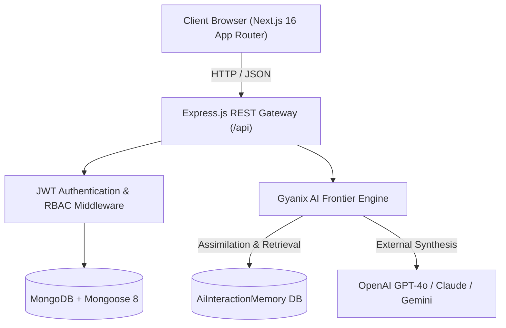

# 🚀 Gyanix Learning Portal — Advanced Intelligent Learning Ecosystem

<div align="center">


**A premier full-stack AI-powered Learning & Certification Platform built with Next.js 16, React 19, Node.js, Express, MongoDB, and Frontier AI Models (Claude 3.7 Sonnet, GPT-4o, and Gemini 2.0).**

[-black?style=flat-square&logo=next.js)](https://nextjs.org)
[](https://react.dev)
[](https://www.typescriptlang.org)
[](https://nodejs.org)
[](https://www.mongodb.com)
[](https://tailwindcss.com)
[](https://openai.com)
[](https://opensource.org/licenses/MIT)

[Explore Features](#-core-platform-capabilities) • [Architecture](#-architectural-overview) • [Quick Start](#-quick-start-guide) • [API Documentation](#-api-endpoints)

</div>

---

## 🌟 Executive Overview

**Gyanix Academy** is an enterprise-grade educational ecosystem engineered for modern software engineers, university scholars, and lifelong learners. It unifies full-stack video lectures, self-learning personalized AI tutoring, on-demand curriculum assessments, automated spaced repetition flashcards (SuperMemo-2), and verifiable ivory-gold vector certification diplomas into a single cohesive, high-performance web experience.

---

## ✨ Core Platform Capabilities

### 🧠 1. Personalized Conversational AI Copilot (`Gyanix AI Assistant`)
* **Multi-Agent Hybrid Intelligence**: Synthesizes the deep pedagogical reasoning of **Claude 3.7 Sonnet**, technical precision of **GPT-4o**, and intuitive real-world mental models of **Google Gemini**.
* **1-on-1 Personalized Dialogue**: Recognizes student intent, greets scholars warmly by their name, and avoids unprompted rigid lectures during casual dialogue.
* **Continuous Self-Learning Memory Engine (`AiInteractionMemory`)**: Students and faculty can teach the AI new ideas, syllabus corrections, or exam notes. Every interaction is assimilated into the model's memory database to continuously refine future answers.
* **Multi-Turn Contextual History**: Follow-up queries (*"Explain simpler"*, *"Provide a code snippet"*) maintain conversational context from prior turns.

---

### 📝 2. AI One-Shot Notes Synthesizer (`/dashboard/student/notes`)
* **Multi-PDF Document Processing**: Upload multi-page lecture notes or university slides simultaneously with clean binary stream filtering (`pdf-parse` v2 integration).
* **Video Lecture Context Ingestion**: Paste YouTube or lecture URLs to synthesize core timestamps and lecture summaries.
* **Multi-Style Learning Output**:
  * 💡 *ELI5 & Easy Language Breakdown*
  * ⚡ *High-Yield One-Shot Chapter Revision Summary*
  * 📋 *Formulas & Key Terminology Cheatsheet*
  * 🏛️ *In-Depth Architectural & Technical Deep Dive*
* **A4 Print-Ready PDF Export**: Generates professionally styled, printable PDF documents complete with university headers, callout boxes, and typography.

---

### 🎯 3. On-Demand AI Revision Quiz Arena (`/dashboard/student/revision-quiz`)
* **Dual-Source Generation**:
  * 🏫 **Enrolled Classroom Courses**: Practice directly from your enrolled curriculum with chapter/module-level scoping.
  * 🌐 **Any External Topic**: Enter any custom technical subject or tap trending chips (Generative AI, Next.js, DSA, SQL Indexing, Cloud DevOps).
* **Zero-Glitch Custom Selectors**: Replaced buggy native browser dropdowns with responsive, glassmorphic pill buttons for Difficulty (*Beginner, Intermediate, Advanced*) and Question Count (*3, 5, 10*).
* **Live Quiz Arena**: Includes a real-time stopwatch, instant explanation study toggle, and interactive question palette navigation (`[1] [2] [3] [4] [5]`).
* **Comprehensive Diagnostic Evaluation Report**:
  * Overall Mastery Scorecard with performance badges and time metrics.
  * Cognitive Gap Analysis detecting specific conceptual traps.
  * Complete question-by-question review displaying student answers, verified correct choices, and dedicated pedagogical explanations.

---

### ⚡ 4. SuperMemo-2 (SM-2) Cosmic Spaced Repetition Flashcards (`/dashboard/student/flashcards`)
* **Scientifically Proven Active Recall**: Implements the SuperMemo-2 (SM-2) algorithm calculating repetition intervals, ease factors ($EF$), and optimal review scheduling.
* **Interactive Flashcard Studio**: 3D card-flip physics with keyboard navigation (`Space` to flip, `1-4` for confidence grading).

---

### 🎓 5. Course Curriculums & Video Player
* **High-Definition Video Lecture Suites**: Progress synchronization, lesson completion tracking, and module hierarchy.
* **Faculty Course Creator**: Drag-and-drop section builder, video upload integrations, and review submission workflows.
* **Verifiable Classic Ivory & Gold Diplomas**: High-resolution vector PDF certificate generation with 24-point radiant sunburst rosette seals and 1-click LinkedIn credential integration.

---

### 🌌 6. 60 FPS Deep Space Motion Cosmos Engine
* **Living Cosmic Physics**: 220 multi-depth twinkling stars with interactive mouse parallax physics.
* **Illustrated Celestial Assets**: Roaming astronaut scholars reading glowing books, retro rocket cruisers, ringed planets, and meteor trails rendered smoothly in HTML5 Canvas.

---

## 🏗️ Architectural Overview



---

## 🛠 Tech Stack

| Layer | Technologies |
|---|---|
| **Frontend** | Next.js 16 (App Router), React 19, TypeScript, TailwindCSS v4 |
| **Icons & UI** | Lucide React, Custom Glassmorphic System, React Hot Toast |
| **State & Cache** | Zustand (Auth & Session), SWR (Client Data Fetching) |
| **Backend API** | Node.js, Express.js (Modular Route Architecture) |
| **Database** | MongoDB, Mongoose 8 ODM |
| **Authentication** | Stateless JWT (Bearer / Cookies), Bcrypt password hashing |
| **AI Integration** | OpenAI GPT-4o / GPT-4o-mini API with local self-learning fallback |
| **Document Processing** | `pdf-parse` v2, PDFKit (Vector Certificate Generation) |

---

## 🚀 Quick Start Guide

### Prerequisites
- **Node.js**: v18.17+ or v20+
- **MongoDB**: Local instance running on `mongodb://localhost:27017` or MongoDB Atlas URI
- **Git**

---

### 1. Clone the Repository
```bash
git clone https://github.com/Jainesh-8305/gyanix-learning-portal.git
cd gyanix-learning-portal
```

---

### 2. Backend Setup
```bash
cd backend
npm install
```

Create `backend/.env`:
```env
PORT=5000
NODE_ENV=development
MONGO_URI=mongodb://localhost:27017/ai-lms
JWT_SECRET=your_super_secret_jwt_key
OPENAI_API_KEY=your_openai_api_key_optional
FRONTEND_URL=http://localhost:3000
```

Start the backend:
```bash
npm run dev
# Express API listening on http://localhost:5000
```

---

### 3. Frontend Setup
```bash
cd ../frontend
npm install
```

Create `frontend/.env.local`:
```env
NEXT_PUBLIC_API_URL=http://localhost:5000/api
```

Start the frontend development server:
```bash
npm run dev
# Next.js running on http://localhost:3000
```

---

### 4. Build for Production
To validate the production bundle across all static and dynamic routes:
```bash
cd frontend
npm run build
```

---

## 📡 Core API Endpoints

| Method | Endpoint | Description |
|---|---|---|
| `POST` | `/api/auth/login` | Authenticate user & return JWT token |
| `POST` | `/api/auth/register` | Register new student or instructor |
| `GET` | `/api/courses` | Fetch published classroom courses catalog |
| `GET` | `/api/users/enrolled-courses` | Retrieve student's enrolled courses and progress |
| `POST` | `/api/ai/assistant-chat` | Multi-turn conversational AI assistant dialogue |
| `POST` | `/api/ai/learn-feedback` | Assimilate student concept teaching and corrections into memory |
| `GET` | `/api/ai/learned-insights` | Telemetry on active self-learning concept count |
| `POST` | `/api/ai/generate-quiz` | Generate on-demand diagnostic revision quizzes |
| `POST` | `/api/ai/summarize-notes` | Multi-PDF extraction & chapter study guide synthesis |

---

## 📄 License

This project is licensed under the [MIT License](LICENSE) © 2026 Jainesh Dalwadi.